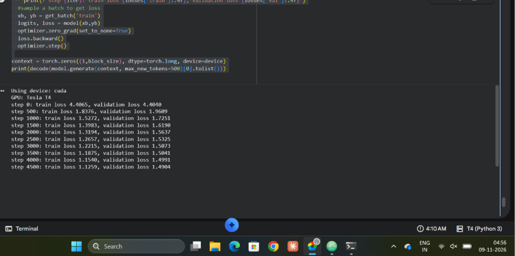
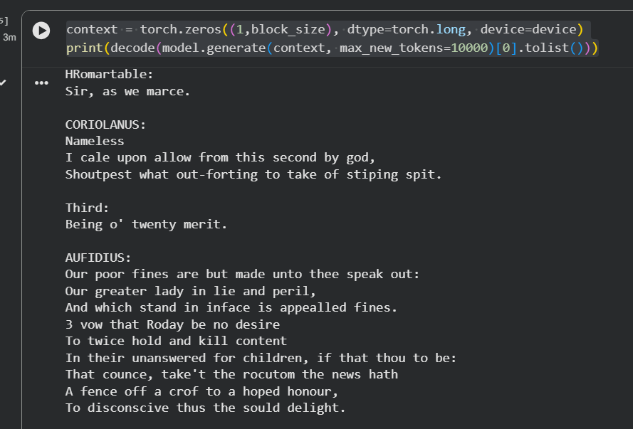
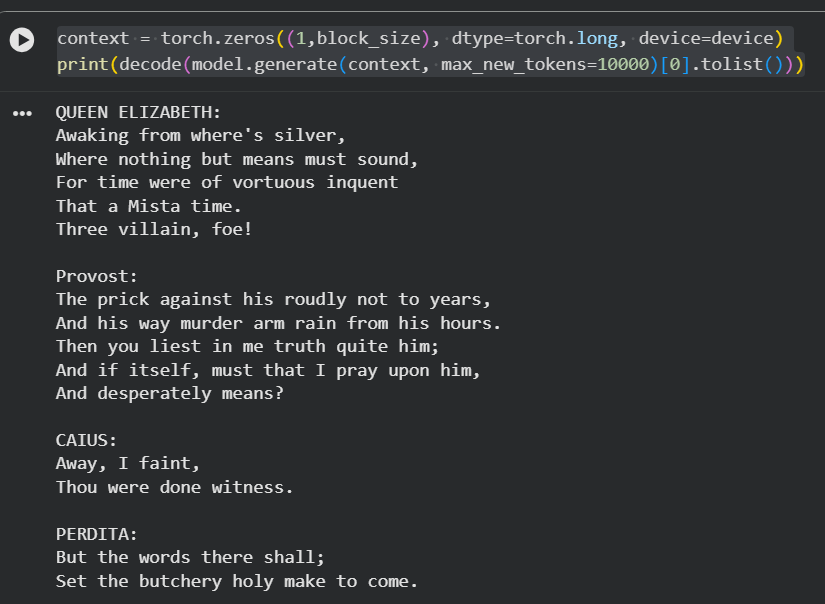
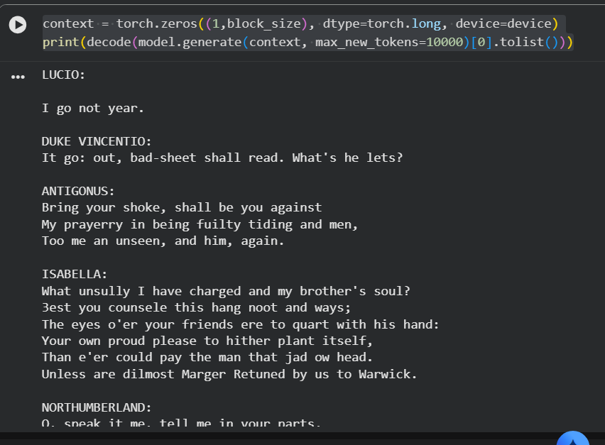

# Mini Decoder Transformer

A from-scratch implementation of a **decoder-only Transformer language model** using Python and PyTorch.

This project documents my journey from understanding neural networks and backpropagation to implementing and training a Transformer model for character-level text generation.

## Training Results

### Training and Validation Loss

### Generated Text Samples

## Learning Path

The `learning-path/` directory contains the progression of concepts and implementations:

1. Backpropagation and Neural Networks
2. Bigram Language Models
3. MLP and Batch Normalization
4. Context-Based Prediction

## Decoder Transformer Implementation

The `decoder-transformer/` directory contains my Transformer implementation, covering:

- Token and positional embeddings
- Self-attention (Query, Key and Value)
- Causal masking
- Multi-head attention
- Feed-forward networks
- Residual connections and Layer Normalization
- Autoregressive text generation

## Training

Trained a character-level decoder-only Transformer on Shakespeare's text using PyTorch.
The model learned character-level patterns and generated text resembling the training corpus.
The model was trained using next-character prediction with a causal self-attention mechanism. It learned character-level patterns and generated text resembling the Shakespeare training corpus.

## Repository Structure

- `learning-path/` – Progressive implementations of foundational deep learning concepts.
- `decoder-transformer-implementation/` – Decoder-only Transformer implementation.
- `data/` – Training dataset.
- `results/` – Training metrics and generated text samples.

## Technologies

Python · PyTorch · NumPy · Linux
